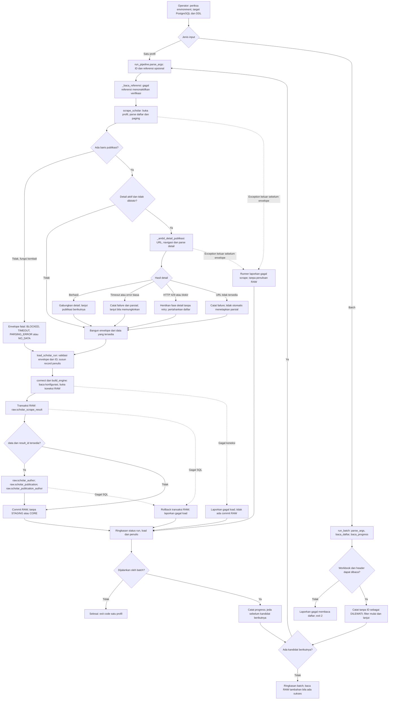

# Buku Panduan Scraping Google Scholar

Panduan pemula untuk repository `telkom-publication-dashboard`.

## 1. Pengenalan dan batas ruang lingkup

Proyek mengumpulkan informasi profil dosen dan publikasi dari Google Scholar, lalu menyimpannya ke PostgreSQL. Alur utama panduan ini berhenti pada lapisan **RAW**, yaitu catatan hasil pengambilan dan data terstruktur yang masih mempertahankan asal sumbernya. RAW tidak berarti seluruh kolom adalah teks halaman tanpa penurunan: beberapa kolom, seperti DOI hasil ekstraksi dan penanda kelengkapan, dihitung oleh kode.

Scraper menggunakan Playwright untuk menjalankan Chromium dan BeautifulSoup untuk membaca HTML. Satu **run** adalah satu percobaan mengambil satu profil. **Envelope** adalah objek hasil run yang memuat data sekaligus status dan kegagalannya.

STAGING, CORE, transformasi lanjutan, enrichment, MART, pemeriksaan indeks jurnal, dan dashboard berada di luar alur utama. Jangan menambahkan `--load-core` ketika mengikuti panduan RAW ini. Fitur tersebut masih tersedia sebagai opsi eksplisit, tetapi memiliki dampak lain. Placeholder validasi dan Prefect tidak dijalankan sebagai tahap wajib scraping.

Panduan disusun dari kode dan DDL repository, bukan dari keberhasilan scraping langsung. Jumlah publikasi yang diperoleh **tidak menjamin seluruh metadata detail dan nama penulis berhasil diperoleh**. Status sukses juga bukan bukti kualitas atau kelengkapan seluruh data.

## 2. Prasyarat dan persiapan lingkungan

### 2.1 Perangkat yang diperlukan

| Kebutuhan | Penjelasan |
|---|---|
| Python | Gunakan Python 3.12 sebagai acuan; README mencatat lingkungan audit 3.12.7. Kompatibilitas seluruh versi lain belum dibuktikan. |
| pip dan virtual environment | Memisahkan dependensi proyek dari paket Python sistem. |
| Paket proyek | Ikuti `requirements.txt`; versi langsung berasal dari lingkungan audit, bukan lock seluruh dependensi transitif. |
| Chromium Playwright | Harus diinstal terpisah setelah paket Python. |
| PostgreSQL | DDL repository memerlukan PostgreSQL 15+; Compose menggunakan PostgreSQL 16. |
| Akses jaringan | Diperlukan untuk instalasi dan akses halaman Scholar; tidak menjamin akses selalu diterima. |
| Klien PostgreSQL | Misalnya pgAdmin atau psql untuk memeriksa target dan menjalankan SELECT. |

Docker/Compose bersifat opsional bila PostgreSQL sudah tersedia. Penyediaan database, role, hak akses, dan penerapan DDL harus selesai sebelum scraping; panduan ini tidak memberikan prosedur migrasi otomatis.

### 2.2 Instalasi dari root repository

Buka terminal pada folder yang memuat `README.md`, `requirements.txt`, dan `src/`. Semua perintah scraping dalam panduan dijalankan dari folder tersebut, bukan dari `docs/guides/`.

PowerShell:

```powershell
python --version
python -m venv .venv
.\.venv\Scripts\Activate.ps1
python -m pip install -r requirements.txt
python -m playwright install chromium
```

Linux/macOS memakai aktivasi `source .venv/bin/activate` setelah virtual environment dibuat. Jika kebijakan PowerShell melarang aktivasi, gunakan interpreter environment secara langsung, misalnya `.\.venv\Scripts\python.exe -m pip install -r requirements.txt`, sesuai kebijakan komputer Anda.

Paket scraping utama adalah `playwright` dan `beautifulsoup4`. SQLAlchemy, psycopg, dan python-dotenv menangani database; openpyxl membaca referensi Excel. Requests dipakai modul terpisah, sedangkan pytest adalah alat pengujian. Instalasi tetap menggunakan satu `requirements.txt`.

### 2.3 Pemeriksaan kesiapan sebelum memulai

1. Pastikan interpreter dan pip berasal dari environment yang sama.
2. Pastikan Chromium Playwright telah tersedia.
3. Siapkan `.env` lokal serta periksa environment proses yang mungkin mengalahkannya.
4. Pastikan database target, tabel RAW, dan hak tabel/sequence sesuai.
5. Siapkan ID profil atau workbook dan lokasi progress.
6. Baca opsi CLI tanpa memulai scraping melalui parser bantuan yang dijelaskan pada bagian 5 dan 6.

Jangan menganggap runner melakukan seluruh pemeriksaan tersebut sebelum browser dibuka. Dalam kode aktual, koneksi RAW baru dibuka setelah scraper menghasilkan envelope.

## 3. Konfigurasi database secara aman

### 3.1 Menyiapkan konfigurasi lokal

Gunakan `.env.example` sebagai template. Jika `.env` sudah ada, edit konfigurasi lokal yang benar; jangan menimpanya. Contoh PowerShell berikut menyalin hanya ketika file belum ada:

```powershell
if (-not (Test-Path -LiteralPath .env)) { Copy-Item .env.example .env }
```

Isi nilainya sendiri di komputer lokal. Jangan mengirim isi `.env`, password, token, atau connection string berkredensial kepada orang lain.

| Variabel aktual | Makna |
|---|---|
| `POSTGRES_HOST` | Host server; kode memakai `localhost` bila kosong. |
| `POSTGRES_PORT` | Port koneksi; default kode `5432`; harus berupa bilangan bulat. |
| `POSTGRES_DB` | Nama database; wajib diisi. Database utama proyek adalah `publication_dashboard`. |
| `POSTGRES_USER` | Role yang dipakai aplikasi; gunakan role ETL dengan hak sesuai. |
| `POSTGRES_PASSWORD` | Password role, disimpan lokal tanpa ditampilkan pada panduan. |

`build_engine()` pada `src/loading/postgres.py` memuat `.env` di root repository. Variabel environment proses yang sudah ada tidak ditimpa oleh `.env`. Template juga menyebut konfigurasi di luar scraping; keberadaan variabel Superset atau `SCHOLAR_PROXY_ENABLED` tidak membuktikan fitur tersebut aktif dalam scraper.

### 3.2 Memastikan target sebelum penulisan

Pada klien database yang terhubung ke host/port dan role yang akan digunakan aplikasi, jalankan:

```sql
SELECT current_database(), current_user;
```

Pastikan target sesuai tujuan, terutama `publication_dashboard` untuk data utama. Runner scraping tidak memiliki guard yang mewajibkan nama database tertentu. Guard modul indeks jurnal tidak berlaku otomatis pada runner ini.

Loader menggunakan tabel yang sudah tersedia, bukan membuatnya sendiri. Minta pengelola database meninjau DDL bernomor pada `sql/ddl/`, termasuk perubahan RAW di file 03, 04, 07, 08, 09, 10, dan 11. `CREATE TABLE IF NOT EXISTS` tidak menambahkan kolom baru ke tabel lama; karena itu riwayat penerapan perubahan harus diperiksa. Jangan menerapkan ulang seluruh SQL tanpa meninjau database yang sudah berisi data.

Compose memasang `sql/ddl/` ke direktori inisialisasi PostgreSQL dan menggunakan named volume `pg_data`. SQL inisialisasi dijalankan pada volume kosong, bukan otomatis setiap file SQL ditambahkan. Jangan menghapus volume untuk memperbarui skema. Port host Compose ditetapkan `5432`; mengubah `POSTGRES_PORT` aplikasi saja tidak mengubah pemetaan port container. Pengguna bootstrap Compose juga tidak otomatis menjadi role ETL dengan hak terbatas.

### 3.3 Batasan opsi koneksi

Parser menyediakan `--url` dan `--echo-sql`, tetapi runner tidak meneruskannya ke writer RAW yang membuka `connect()` sendiri. Pada mode RAW, penulisan tetap menggunakan `.env`/environment. Pada mode lanjutan, `--url` dapat mengubah koneksi CORE sehingga target RAW dan CORE berpotensi berbeda. Untuk panduan ini, gunakan konfigurasi environment dan jangan memakai opsi tersebut. Log SQL juga dapat memuat parameter data; jangan membagikannya tanpa pemeriksaan.

## 4. Struktur input dan penggunaan scholar_id

### 4.1 ID profil

Pada alamat profil dengan parameter `user`, ambil **nilai parameter tersebut**, bukan URL lengkap. Contoh konseptual `...?user=SCHOLAR_ID_ANDA` berarti inputnya `SCHOLAR_ID_ANDA`. Teks ini adalah placeholder: ganti dengan ID profil yang benar sebelum menjalankan perintah.

Selalu berikan `--id` secara eksplisit karena runner memiliki ID bawaan. CLI menerima string ID; jangan menganggapnya memeriksa identitas pemilik atau kebenaran profil secara lengkap. Identitas input juga disimpan agar run gagal tetap dapat ditelusuri.

Untuk ID yang diawali tanda minus, gunakan bentuk `--id=ID_PROFIL_ANDA` agar argparse tidak membacanya sebagai opsi baru.

### 4.2 Workbook dosen

Contoh lokasi lokal adalah `data dosen/Data dosen.xlsx`. Folder ini diabaikan Git. Tabel berikut hanya menggambarkan struktur, bukan data dosen nyata:

| no | nama | scholar_id | prodi |
|---|---|---|---|
| 1 | Nama sesuai referensi | ID profil sebenarnya | Program studi, jika tersedia |

Aturan `baca_daftar()`:

- `scholar_id` wajib ada pada header baris pertama. Isi dengan ID, bukan URL lengkap.
- Header dicocokkan setelah penghapusan spasi tepi dan perubahan ke huruf kecil.
- Gunakan juga header `no` dan `nama` agar tidak bergantung pada fallback posisi kolom pertama/kedua. `prodi` opsional.
- `Sheet1` dipilih jika tersedia; jika tidak, sheet pertama digunakan.
- Baris yang seluruh selnya kosong diabaikan. Baris berisi data tanpa ID dicatat `DILEWATI` oleh batch dan tidak dikirim ke scraper.
- Workbook dibuka read-only dengan `data_only=True`. Gunakan nilai sel yang sudah tersimpan, terutama bila workbook memakai rumus.

Pada satu profil, `--referensi-dosen` default menunjuk workbook tersebut. Jika tidak ada, rusak, atau tidak memiliki kolom wajib, runner satu profil tetap berjalan tetapi verifikasi identitas dinonaktifkan. Pada batch, workbook adalah daftar kerja wajib: kegagalan membacanya menghentikan batch sebelum scraping.

## 5. Menjalankan scraping satu profil

### 5.1 Perintah utama

Setelah kesiapan database dipastikan, jalankan:

```sh
python -m src.pipeline.run_pipeline --id SCHOLAR_ID_ANDA
```

Bentuk skrip yang setara:

```sh
python src/pipeline/run_pipeline.py --id SCHOLAR_ID_ANDA
```

Default-nya headless, mengambil detail jika memungkinkan, lalu berhenti setelah penyimpanan RAW. Menjalankan perintah ini membuka browser otomatis dan menulis data; contoh tidak dijalankan ketika panduan dibuat.

### 5.2 Variasi yang tersedia

```sh
python -m src.pipeline.run_pipeline --id SCHOLAR_ID_ANDA --headed --batch 5 --tampil 10
python -m src.pipeline.run_pipeline --id SCHOLAR_ID_ANDA --tanpa-detail
python -m src.pipeline.run_pipeline --id SCHOLAR_ID_ANDA --referensi-dosen "data dosen/Data dosen.xlsx" --raw-only
```

`--headed` menampilkan browser untuk pengamatan, bukan menjamin lolos pembatasan. `--tanpa-detail` mengurangi permintaan detail tetapi dapat mengurangi kelengkapan metadata/nama; ini bukan cara melengkapi data yang hilang.

| Opsi satu profil | Fungsi dan default |
|---|---|
| `--id` | ID profil; isi eksplisit. |
| `--headed` | Browser terlihat; default tidak terlihat. |
| `--tanpa-detail` | Lewati fase detail; default fase detail aktif. |
| `--batch` | Batas putaran daftar; default 60. Lihat penjelasan penghitungan di bawah. |
| `--tampil` | Baris tabel terminal; default 20, nilai 0 tidak mencetak tabel. Tidak membatasi data yang disimpan. |
| `--diam` | Mengurangi progress scraper; ringkasan dan pesan tertentu tetap dicetak. |
| `--referensi-dosen` | Excel referensi identitas; default `data dosen/Data dosen.xlsx`. |
| `--raw-only` | Menegaskan mode default RAW. |
| `--load-core` | Mengaktifkan pemrosesan lanjutan; jangan dipakai dalam alur utama ini. |
| `--url`, `--echo-sql` | Ada pada CLI; batasan dan risiko dijelaskan pada bagian 3.3. |
| `-h`, `--help` | Membaca bantuan tanpa menjalankan `main()` sampai scraping. |

**Arti teknis `--batch`:** teks bantuan menyebut batas klik "Tampilkan lainnya", tetapi implementasi menetapkan `batches=1` setelah halaman awal lalu mengulang selama `batches < max_batches`. Jadi halaman awal sudah dihitung; nilai 1 tidak melakukan klik tambahan. Opsi ini bukan jumlah dosen atau jumlah publikasi. Gunakan bilangan bulat positif. Mencapai batas menandai hasil parsial secara konservatif, bahkan jika publikasi yang tersedia kebetulan sudah termuat.

## 6. Menjalankan scraping batch

### 6.1 Perintah utama

```sh
python src/pipeline/run_batch.py --file "data dosen/Data dosen.xlsx" --lanjut
```

Bentuk modul juga tersedia:

```sh
python -m src.pipeline.run_batch --file "data dosen/Data dosen.xlsx" --lanjut
```

Batch memanggil runner satu profil secara berurutan, bukan paralel. File `--file` otomatis menjadi referensi identitas setiap profil. Contoh pengaturan tambahan:

```sh
python src/pipeline/run_batch.py --file "data dosen/Data dosen.xlsx" --lanjut --jeda 15 --batch 5 --tampil 0
python src/pipeline/run_batch.py --file "data dosen/Data dosen.xlsx" --lanjut --mulai 10 --progress "data dosen/progress_batch.csv"
```

Nilai jeda pada contoh bukan jaminan akses diterima. Selalu berhenti bila layanan membatasi akses.

| Opsi batch | Perilaku aktual |
|---|---|
| `--file` | Wajib; workbook daftar dan referensi identitas. |
| `--lanjut` | Melewati ID dengan status terminal pada progress. |
| `--ulang` | Mengabaikan filter terminal `--lanjut`; filter `--mulai` tetap berlaku. |
| `--mulai` | Baris data ke-N, 1-based; default 1. Bukan nomor header Excel. Nilai di bawah 1 dikoreksi menjadi 1. |
| `--jeda` | Jeda antarprofil, default 8 detik; nilai negatif dikoreksi menjadi 0. Jangan memakai 0 untuk mempercepat akses berlebihan. |
| `--progress` | Default `data dosen/progress_batch.csv`. Gunakan lokasi yang dapat ditulis dan jangan menimpa catatan yang masih diperlukan. |
| `--headed` | Diteruskan ke runner satu profil. |
| `--batch` | Diteruskan sebagai batas putaran daftar per profil; jika tidak diisi, memakai default runner 60. |
| `--tampil` | Baris tabel per profil; default batch 0. |
| `--diam` | Diterima, tetapi batch selalu meneruskan mode diam. |
| `--raw-only` | Mode default, diteruskan eksplisit. |
| `--load-core` | Opsi lanjutan di luar ruang lingkup. |
| `--url`, `--echo-sql` | Diteruskan, dengan batasan koneksi RAW pada bagian 3.3. |
| `-h`, `--help` | Menampilkan bantuan. |

Batch tidak menyediakan `--tanpa-detail` atau `--referensi-dosen` sebagai opsi tersendiri. Jangan menyalin semua opsi satu profil ke perintah batch.

### 6.2 Progress, melanjutkan, dan mengulang

CSV memuat `scholar_id`, `nama`, `status`, `exit_code`, dan `waktu`. `tulis_progress()` menambahkan baris dan melakukan flush. `baca_progress()` memakai catatan terakhir per ID. Pembaca menangani pemisah koma/titik koma per baris; baris rusak dapat diabaikan dan akibatnya profil tidak dikenali sebagai selesai. Jangan menyimpan ulang CSV lewat Excel saat proses berjalan.

Status terminal yang dilewati `--lanjut` adalah **`OK`, `OK_RAW`, `GAGAL_LOAD`, `GAGAL_SCRAPE`, dan `DILEWATI`**. `GAGAL` tidak terminal. Jadi `--lanjut` bukan perintah untuk mencoba ulang semua kegagalan. Hasil parsial yang dicatat `OK_RAW` juga dilewati.

Untuk satu profil yang perlu diperiksa ulang, lebih terarah menjalankan perintah satu profil setelah penyebab masalah ditangani. `--ulang` dapat mengulang banyak kandidat setelah filter `--mulai`, menghasilkan run baru, dan menambah beban layanan. Jangan langsung menggunakannya hanya karena sebagian metadata kosong. Hentikan batch dengan Ctrl+C bila diperlukan; profil yang sedang diproses perlu diperiksa kembali sebelum dilanjutkan.

## 7. Alur internal aktual dan diagram

### 7.1 Diagram utama yang dapat diedit

Diagram berikut menggambarkan default RAW. Kotak persiapan manual adalah tanggung jawab operator, bukan guard otomatis sebelum browser. Kegagalan scraping yang menghasilkan envelope tetap menuju percobaan penyimpanan; kegagalan sebelum envelope tidak demikian.



Cabang kegagalan argumen berhenti di parser. Interupsi pengguna menghentikan runner/batch dengan exit 130; tidak digambar sebagai jalur lanjut. Pada fase daftar, kegagalan paging sesudah data tersedia mempertahankan baris yang sudah diperoleh dan dapat menghasilkan parsial. Diagram merangkum loop detail; kode mengevaluasi publikasi satu per satu sebelum membentuk envelope.

### 7.2 Penjelasan setiap tahap

| Tahap | Fungsi/modul aktual | Penjelasan sederhana |
|---|---|---|
| Input | `run_pipeline.parse_args`, `run_batch.parse_args` | Membaca opsi dan tipe argumen, bukan pemeriksaan lengkap kualitas sumber. |
| Workbook dan progress | `baca_daftar`, `baca_progress`, `run_batch.main` | Menentukan kandidat; tanpa ID tidak di-scrape. |
| Referensi identitas | `run_pipeline._baca_referensi` | Kegagalan referensi tidak menghentikan satu profil. |
| Pengambilan daftar | `scrape_scholar`, `parse_profile_html`, `_collect_rows` | Membaca halaman dan tombol pemuatan tambahan; baris tanpa judul dicatat sebagai kegagalan dan tidak dimasukkan ke baris valid. |
| Pengambilan detail | `_ambil_detail_publikasi`, `parse_detail_html` | Mengisi metadata tambahan bila tersedia; data daftar tetap dipertahankan ketika detail gagal. |
| Envelope dan status | `_classify_status`, `_make_data`, `_make_envelope` | Menghasilkan catatan run yang memuat data serta keterbatasannya. |
| Record penulis | `write_raw_scrape_result`, `bangun_record_author` | Memilih teks detail bila terisi, selain itu daftar; menyimpan urutan dan status identitas tanpa mengarang nama. |
| Konfigurasi koneksi | `build_engine`, `connect` | Memuat konfigurasi dan membuka koneksi RAW setelah scraping. |
| Penulisan | `load_scholar_run`, `write_raw_scrape_result` | Menulis envelope dan tabel terstruktur dalam satu transaksi; gagal SQL membatalkan transaksi RAW tersebut. |
| Pelaporan | `run_pipeline.main`, `tulis_progress`, `run_batch.main` | Membedakan status sumber, penyimpanan, progress, dan exit code. |

Envelope memiliki sembilan kunci: `run_id`, `source`, `started_at`, `finished_at`, `status`, `records_fetched`, `records_failed`, `error_message`, dan `data`. Jika data ada, `data` memuat `scholar_id`, `name`, `h_index`, `rows`, `failures`, `domain`, `batches`, dan `elapsed`. Pada run fatal tanpa baris, `data` bernilai null.

`records_fetched` dihitung dari jumlah baris yang terkumpul. `records_failed` dihitung dari jumlah entri kegagalan jika data ada, bukan hitungan pasti semua publikasi atau field yang hilang. Saat detail dihentikan, baris berikutnya belum dicoba dan tidak mendapat satu failure per baris. Pada run fatal, hitungan gagal dapat 0; lihat status dan pesan, bukan angka itu saja.

Percobaan baru membuat `run_id` baru. Pengamanan konflik untuk retry run yang sama tidak berarti scraping ulang dengan run baru menghapus atau menggabungkan seluruh duplikasi antar-run. Paging juga menggunakan judul yang sudah terlihat untuk menyaring penambahan baris; hal itu bukan resolusi identitas publikasi yang sempurna.

## 8. Struktur tabel RAW dan data penulis

### 8.1 Empat tabel scraping

| Tabel | Kolom penting berdasarkan DDL | Fungsi |
|---|---|---|
| `raw.scholar_scrape_result` | `result_id`, `scholar_id`, `scraped_at`, `run_id`, `status`, `raw_envelope` | Catatan run dan envelope JSONB; dapat merekam kegagalan. |
| `raw.scholar_author` | `raw_author_id`, `result_id`, `urutan`, `scholar_id`, `nama`, `h_index`, `domain`, `batches`, `elapsed`, `prodi` | Profil yang diperoleh pada run; `urutan` penulisan profil adalah 0. |
| `raw.scholar_publication` | `raw_publication_id`, `result_id`, `urutan`, `scholar_id`, `title`, `authors`, `venue`, `extra`, `citations`, `year`, `publication_year`, kelompok `detail_*`, `profile_volume`, `profile_issue`, `profile_pages`, `status` | Publikasi per run, teks daftar/detail dan metadata turunannya. |
| `raw.scholar_publication_author` | `raw_publication_author_id`, `raw_publication_id`, `author_order`, `author_name`, `author_role`, `profile_owner_status`, `scholar_id`, `sumber`, `daftar_terpotong`, `created_at` | Satu record untuk setiap posisi penulis yang dapat dibaca. |

Kelompok detail yang didefinisikan DDL adalah `detail_url`, `detail_title`, `detail_authors`, `detail_date`, `detail_venue`, `detail_volume`, `detail_issue`, `detail_pages`, `detail_publisher`, `detail_description`, `detail_citations`, `detail_link`, `detail_pdf_link`, dan `detail_doi`. Nilai null tidak otomatis berarti informasi tersebut tidak ada pada sumber; bisa belum diperoleh, tidak dapat diparse, atau tidak dicoba.

Hubungan foreign key DDL untuk keempat tabel tersebut:

- `raw.scholar_author.result_id` menuju `raw.scholar_scrape_result.result_id`.
- `raw.scholar_publication.result_id` menuju `raw.scholar_scrape_result.result_id`.
- `raw.scholar_publication_author.raw_publication_id` menuju `raw.scholar_publication.raw_publication_id`.

Tidak ada foreign key langsung dari record penulis publikasi menuju `raw.scholar_author`. Pemilik profil dan daftar penulis publikasi merupakan informasi berbeda. Penulis publikasi ditelusuri ke run melalui publikasi induknya.

`run_id` memiliki constraint unik. Pasangan `(result_id, urutan)` unik pada tabel profil dan publikasi, sedangkan `(raw_publication_id, author_order)` unik pada tabel penulis publikasi. Keunikan tersebut tidak berarti nama orang atau publikasi antar-run sudah dideduplikasi.

### 8.2 Asal nama, urutan, dan verifikasi

Jika `detail_authors` terisi setelah pemeriksaan teks, loader memakainya; jika tidak, loader memakai `authors` dari daftar profil. Nama dipecah oleh helper sesuai teks yang dapat dibaca dan urutannya. Daftar kosong menghasilkan nol record, bukan nama buatan.

| Field | Arti |
|---|---|
| `author_order` | Posisi 0-based; posisi pertama adalah 0. |
| `author_role` | `penulis_pertama` untuk posisi 0; `co_author` untuk posisi berikutnya. Bukan penanda corresponding author atau kontribusi ilmiah. |
| `profile_owner_status` | `pemilik_profil`, `bukan_pemilik_profil`, atau `belum_terverifikasi`, sesuai hasil aturan verifikasi kode. |
| `scholar_id` pada record penulis | Diisi hanya untuk pemilik profil yang terverifikasi; record lainnya null. ID profil asal tetap ada pada publikasi dan run. |
| `sumber` | `detail` atau `daftar`; asal teks, bukan sertifikat kelengkapan daftar. |
| `daftar_terpotong` | True jika sumber daftar memuat token elipsis yang dikenali; false bukan bukti bahwa semua nama sudah diperoleh. |

Gerbang referensi memeriksa ID eksak setelah strip dan nama profil terhadap referensi setelah normalisasi spasi/casefold; referensi ambigu ditolak. Setelah gerbang lolos, posisi pemilik dicocokkan dengan aturan nama eksak, inisial, dan varian tertentu yang dibatasi menurut sumber. Ini aturan kode, bukan verifikasi identitas independen untuk seluruh co-author. Tanpa gerbang yang lolos, semua record berstatus `belum_terverifikasi` dan ID penulis null. `prodi` juga hanya diisi dari referensi yang lolos; nama tidak diganti dengan tebakan atau ekspansi dari Excel.

Pemilik profil dapat berada pada posisi co-author. `bukan_pemilik_profil` tidak berarti identitas co-author sudah ditemukan, dan bukan bukti kepemilikan profil Scholar lain.

### 8.3 Dua jenis status yang berbeda

`raw.scholar_scrape_result.status` adalah status run, misalnya `SUCCESS`. Sebaliknya, `raw.scholar_publication.status` adalah hasil `_status_kelengkapan_metadata()`: `yes` jika `detail_volume`, `detail_issue`, `detail_pages`, dan `detail_description` semuanya terisi; `no` jika salah satunya tidak lengkap. Null dapat berasal dari baris lama yang belum dihitung. Penanda ini tidak menguji kelengkapan nama penulis, seluruh metadata, ataupun kualitas publikasi.

`detail_doi` diturunkan dari tautan detail/PDF. Null bukan bukti bahwa artikel tidak memiliki DOI. `profile_volume`, `profile_issue`, dan `profile_pages` berasal dari ekstraksi teks daftar, berbeda sumber dari kolom detail, dan tidak boleh dianggap identik begitu saja.

## 9. Memeriksa hasil dengan SELECT

Seluruh contoh berikut hanya SELECT. Jalankan sendiri pada target yang sudah diverifikasi, dengan hak baca yang sesuai. Tidak ada query yang dijalankan saat pembuatan panduan. Angka `123` adalah contoh `result_id`; ganti dengan ID hasil run yang sedang diperiksa.

### 9.1 Catatan run terbaru

```sql
SELECT result_id, scholar_id, run_id, scraped_at, status,
       raw_envelope ->> 'records_fetched' AS records_fetched,
       raw_envelope ->> 'records_failed' AS records_failed,
       raw_envelope ->> 'error_message' AS error_message,
       raw_envelope -> 'data' -> 'failures' AS failures
FROM raw.scholar_scrape_result
ORDER BY result_id DESC
LIMIT 20;
```

`records_fetched` dan `records_failed` berada di JSONB, bukan kolom langsung tabel. Catat `result_id` sebelum memeriksa anak tabelnya. `scraped_at` adalah waktu pencatatan di database, bukan pengganti waktu mulai/selesai pada envelope.

### 9.2 Profil dan publikasi pada satu run

```sql
SELECT raw_author_id, result_id, scholar_id, nama, h_index, prodi
FROM raw.scholar_author
WHERE result_id = 123
ORDER BY urutan;
```

```sql
SELECT raw_publication_id, result_id, urutan, title, authors,
       detail_authors, detail_url, publication_year,
       detail_volume, detail_issue, detail_pages,
       detail_description, detail_doi, status AS metadata_detail_lengkap
FROM raw.scholar_publication
WHERE result_id = 123
ORDER BY urutan;
```

Run fatal dengan `data=null` dapat memiliki catatan run tanpa baris profil/publikasi. Periksa envelope dan status sebelum menyimpulkan data hilang karena kesalahan database.

### 9.3 Publikasi dan penulisnya

```sql
SELECT p.raw_publication_id, p.title,
       a.author_order, a.author_name, a.author_role,
       a.profile_owner_status, a.scholar_id,
       a.sumber, a.daftar_terpotong
FROM raw.scholar_publication AS p
LEFT JOIN raw.scholar_publication_author AS a
       ON a.raw_publication_id = p.raw_publication_id
WHERE p.result_id = 123
ORDER BY p.urutan, a.author_order;
```

LEFT JOIN mempertahankan publikasi tanpa record penulis. Satu publikasi bisa menghasilkan beberapa baris join; jangan menghitung baris join sebagai jumlah publikasi unik.

### 9.4 Ringkasan per run tanpa penggandaan join

```sql
SELECT r.result_id, r.status,
       (SELECT count(*) FROM raw.scholar_publication AS p
        WHERE p.result_id = r.result_id) AS jumlah_publikasi,
       (SELECT count(*)
        FROM raw.scholar_publication_author AS a
        JOIN raw.scholar_publication AS p
          ON p.raw_publication_id = a.raw_publication_id
        WHERE p.result_id = r.result_id) AS jumlah_record_penulis
FROM raw.scholar_scrape_result AS r
WHERE r.result_id = 123;
```

Jumlah record penulis bukan jumlah orang unik. Simpan interpretasi hasil bersama run dan sumbernya, bukan hanya angka ringkasan.

## 10. Status, parsial, timeout, dan rate limit

### 10.1 Status scraper

| Status | Makna dalam klasifikasi kode |
|---|---|
| `SUCCESS` | Ada data dan tidak ada penanda proses parsial; tidak menjamin seluruh field lengkap. |
| `PARTIAL_SUCCESS` | Ada data dengan penanda parsial, misalnya batas putaran tercapai, paging bermasalah, atau kegagalan detail. |
| `BLOCKED` | Tidak ada baris data dan terdeteksi CAPTCHA/unusual traffic atau redirect halaman blokir. |
| `TIMEOUT` | Tidak ada data dengan penanda gangguan navigasi/jaringan; juga dipakai untuk HTTP awal >=400, termasuk 429 yang benar-benar diamati. Baca pesan spesifiknya. |
| `PARSING_ERROR` | Tanpa data dan ada kegagalan parsing yang diklasifikasikan demikian. |
| `NO_DATA` | Tanpa baris data dan tidak masuk prioritas fatal lainnya; bukan bukti pasti bahwa profil tidak memiliki publikasi. |

Jika data sudah ada lalu fase berikutnya diblokir, hasil dapat `PARTIAL_SUCCESS`, bukan `BLOCKED`. `error_message` mempertahankan pesan pertama; jangan menganggapnya daftar seluruh masalah. Detail tambahan berada di `failures`.

### 10.2 Keadaan detail yang perlu dibedakan

| Keadaan | Perilaku |
|---|---|
| URL detail tidak tersedia | Failure `detail_url_tidak_tersedia`; tidak otomatis menetapkan parsial. |
| Timeout navigasi/selector tanpa blokir, atau HTTP detail selain 429 | Failure `detail_fetch_error`, parsial; umumnya lanjut ke publikasi berikutnya. |
| Parsing detail gagal | Failure `detail_parse_error`, parsial; data daftar tetap ada. |
| HTTP detail 429 | Failure `detail_fetch_error`, parsial, loop detail berhenti tanpa retry otomatis. |
| CAPTCHA/halaman blokir saat detail | Failure `detail_blocked`, fase detail berhenti; data daftar dipertahankan. |
| Detail berhasil diparse, tetapi field tidak tersedia | Nilai dapat tetap null; belum tentu menjadi failure atau parsial. |
| `--tanpa-detail` | Detail sengaja tidak diminta; jangan menafsirkan kolom kosong sebagai kegagalan akses. |

Saat fase detail dijalankan, field detail baris disiapkan dengan nilai null; nilai yang berhasil diparse kemudian mengisinya. Setelah 429/blokir, publikasi berikutnya belum dicoba, sehingga jumlah failure dapat lebih kecil dari jumlah publikasi dengan detail kosong. Timeout navigasi/selector menggunakan `TIMEOUT_MS=20000` pada kode yang diperiksa; ini bukan batas durasi total run dan tidak tersedia sebagai opsi timeout pada kedua CLI.

### 10.3 Status penyimpanan dan exit code

Pada default RAW, status load `RAW_ONLY` menunjukkan runner selesai pada RAW untuk run nonfatal. Run fatal yang berhasil dicatat tetap mengembalikan status scraper fatal. `penyimpanan_author`, `author_disimpan`, dan `author_dilewati_konflik` membantu membedakan komputasi record, penulisan, dan konflik retry. Nol penulis tersimpan bukan otomatis kegagalan apabila tidak ada daftar nama atau run fatal.

| Exit | Satu profil pada default RAW | Batch |
|---|---|---|
| 0 | Penyimpanan run nonfatal berhasil; termasuk parsial. | Tidak ada kegagalan pada kandidat yang diproses saat itu. |
| 1 | Gagal load atau kesalahan pada tahap load. | Ada kandidat gagal. |
| 2 | Scraping fatal/exception sebelum envelope; kesalahan parser CLI juga dapat memberi 2. | Daftar tidak terbaca; kesalahan parser juga dapat memberi 2. |
| 130 | Interupsi pengguna. | Batch dihentikan pengguna. |

CSV batch memakai `OK_RAW` untuk exit 0 pada RAW, `GAGAL_LOAD` untuk 1, `GAGAL_SCRAPE` untuk 2, `GAGAL` untuk kegagalan lain, dan `DILEWATI` untuk tanpa ID. `OK` adalah status mode lanjutan, bukan target panduan ini. Ringkasan batch mencoba membaca RAW untuk kandidat sukses, tetapi pembacaan tambahan tersebut bukan pemeriksaan kelengkapan atau keberhasilan CORE. Exit batch 0 juga tidak mengevaluasi ulang kegagalan lama yang dilewati `--lanjut`.

## 11. Troubleshooting

| Gejala | Kemungkinan penyebab | Pemeriksaan | Solusi aman |
|---|---|---|---|
| `ModuleNotFoundError` | Environment salah atau dependensi belum terpasang. | Periksa interpreter aktif dan lokasi root. | Instal dari requirements menggunakan interpreter environment yang sama; jangan menambah paket tanpa alasan. |
| Chromium tidak ditemukan | Paket Playwright ada, browser belum terinstal. | Periksa pesan executable browser. | Jalankan instalasi Chromium pada environment yang digunakan. |
| Aktivasi PowerShell ditolak | Kebijakan eksekusi komputer. | Baca pesan kebijakan lokal. | Gunakan interpreter `.venv` secara langsung atau ikuti kebijakan administrator; jangan menonaktifkan perlindungan secara luas. |
| `--id` dianggap tidak memiliki nilai | ID diawali minus. | Periksa bentuk argumen. | Gunakan bentuk `--id=...` dengan ID yang benar. |
| Batch tidak mulai | File salah, workbook rusak, atau header wajib hilang. | Periksa path, sheet, dan header `scholar_id`. | Perbaiki salinan input yang berwenang; jangan mengarang ID. |
| Referensi identitas tidak dipakai | File satu profil tidak terbaca atau tidak cocok. | Periksa pesan referensi dan kolom nama/ID. | Koreksi sumber referensi; pertahankan `belum_terverifikasi` sampai ada bukti. |
| Banyak detail null | Sumber tidak memuat field, detail dilewati/gagal, atau fase dihentikan. | Periksa opsi, URL, `failures`, dan status run. | Jangan isi nilai dugaan; ulangi profil secara terbatas hanya setelah penyebab ditangani. |
| `PARTIAL_SUCCESS` tetapi failure kosong | Batas putaran atau paging berhenti tanpa failure per publikasi. | Baca `error_message`, `data.batches`, dan opsi `--batch`. | Tinjau kebutuhan kelengkapan; jangan mengulang seluruh batch tanpa evaluasi. |
| `SUCCESS` tetapi metadata tidak lengkap | Status mengukur jalannya proses, bukan seluruh field. | Periksa detail dan penanda metadata per publikasi. | Laporkan keterbatasan apa adanya. |
| HTTP 429, CAPTCHA, sorry-page | Pembatasan akses atau halaman blokir. | Bedakan respons HTTP yang diamati dari redirect/blokir HTML. | Hentikan percobaan berulang, beri jeda, ikuti aturan layanan; jangan memakai rotasi identitas/proxy untuk menghindari pembatasan. |
| Koneksi/permission database gagal | Layanan, target, kredensial, role atau hak sequence/tabel tidak sesuai. | Periksa konfigurasi lokal dan target melalui klien tanpa membagikan rahasia. | Minta pengelola memperbaiki akses; jangan memakai superuser sebagai jalan pintas. |
| Kolom/tabel tidak ditemukan | DDL belum sesuai versi kode. | Bandingkan struktur database dengan DDL RAW. | Tinjau penerapan perubahan bersama pengelola; jangan menghapus volume atau menjalankan migrasi sembarangan. |
| `--url` tidak mengubah target RAW | Opsi tidak diteruskan ke writer RAW. | Periksa environment dan bagian 3.3. | Gunakan `.env`/environment yang benar, lalu verifikasi target. |
| `--lanjut` melewati profil gagal/parsial | Statusnya terminal, termasuk `OK_RAW` dan kegagalan tertentu. | Baca catatan terakhir CSV dan envelope. | Jalankan ulang profil yang dipilih setelah peninjauan; jangan menghapus progress untuk memaksa ulang. |
| Profil terulang padahal memakai progress | Lokasi progress berbeda atau baris rusak diabaikan. | Periksa `--progress`, header, ID dan format CSV. | Simpan salinan catatan, periksa format; jangan mengedit file saat batch berjalan. |

Jika penulisan tabel terstruktur gagal, transaksi RAW di-rollback, termasuk envelope pada transaksi itu. Jangan menyatakan RAW aman hanya karena terminal sudah mencetak hasil scrape. Pastikan commit/ringkasan load atau periksa catatan dengan SELECT. Interupsi mendadak juga perlu pemeriksaan run terakhir; progress dan database bukan satu transaksi yang sama.

## 12. Praktik yang bertanggung jawab dan batasan

- Gunakan pengumpulan sesuai izin, kebutuhan akademik, dan ketentuan layanan yang berlaku. Akses publik tidak otomatis berarti bebas dikumpulkan atau disebarkan tanpa batas.
- Mulai dari satu profil untuk memahami hasil dan target penulisan. Hindari menjalankan banyak batch bersamaan atau pengulangan luas yang tidak diperlukan.
- Hormati rate limit dan halaman blokir. Kode menghentikan fase detail pada 429/blokir, tetapi itu bukan jaminan seluruh akses memenuhi batas layanan. Jangan mencoba menghindari CAPTCHA atau pembatasan.
- Pertahankan catatan run, sumber nama, status verifikasi, dan penanda terpotong. Jangan memperluas inisial, mengisi nama yang hilang, atau menempelkan ID kepada co-author berdasarkan kemiripan saja.
- Perlakukan roster dosen, progress, hasil RAW, dan log sebagai data yang perlu dibatasi aksesnya. `.gitignore` mencegah pelacakan tertentu, bukan mekanisme enkripsi atau kontrol akses.
- Perubahan tampilan Scholar, jaringan, pemuatan JavaScript, dan data sumber dapat memengaruhi parser. Fixture adalah contoh regresi, bukan jaminan kompatibilitas dengan semua halaman terkini.
- RAW tidak membuktikan data bersih, identitas global penulis benar, publikasi bebas duplikasi, atau metadata lengkap. Nilai kosong harus dipahami bersama konteks proses.

## 13. Referensi dan batas verifikasi

Semua tautan berikut relatif terhadap lokasi panduan ini.

| Referensi | Kegunaan |
|---|---|
| [README](../../README.md), [requirements](../../requirements.txt) | Ringkasan setup dan daftar paket. |
| [Template konfigurasi](../../.env.example), [aturan ignore](../../.gitignore), [Compose](../../compose.yml) | Nama variabel dan perilaku penyediaan database; jangan membagikan `.env` lokal. |
| [Runner satu profil](../../src/pipeline/run_pipeline.py) | Parser, referensi, pemanggilan scraper/loader, status dan exit. |
| [Runner batch](../../src/pipeline/run_batch.py) | Pembacaan Excel/progress, kandidat, penerusan opsi dan ringkasan. |
| [Scraper dan parser](../../src/ingestion/scrape_scholar_playwright.py) | Daftar, detail, status, timeout, blokir dan rate limit. |
| [Loader PostgreSQL](../../src/loading/postgres.py), [helper penulis](../../src/loading/author_records.py) | Konfigurasi koneksi, transaksi RAW, pemilihan sumber nama dan verifikasi. |
| [DDL 03](../../sql/ddl/03_create_raw_scrape_result.sql), [DDL 04](../../sql/ddl/04_create_raw_structured.sql) | Envelope, profil dan publikasi. |
| [DDL 07](../../sql/ddl/07_add_raw_publication_detail_doi.sql), [08](../../sql/ddl/08_add_raw_publication_profile_metadata.sql), [09](../../sql/ddl/09_add_raw_publication_status.sql) | Kolom DOI, bibliografi profil dan penanda metadata. |
| [DDL 10](../../sql/ddl/10_create_raw_publication_author.sql), [11](../../sql/ddl/11_add_raw_scholar_author_prodi.sql) | Record penulis publikasi, relasi, dan prodi profil. |
| [Tes scraper](../../tests/test_scraper.py), [fixture Scholar](../../fixtures/scholar/) | Parser serta skenario navigasi dengan pengganti browser; fixture profil, detail jurnal, dan konferensi. |
| [Tes loader](../../tests/test_database.py), [tes record penulis](../../tests/test_author_records.py) | RAW-only, konflik, transaksi dan aturan identitas dengan data/koneksi tiruan. |
| [Tes satu profil](../../tests/test_run_pipeline.py), [tes batch](../../tests/test_run_batch.py) | Default RAW, referensi, argumen, status dan progress. |
| [Pembahasan ERD](../PEMBAHASAN%20ERD%20DATABASE%20PUBLICATION.pdf), [rencana historis](../superpowers/plans/2026-10-09-revisi-pipeline-4-layer.md) | Konteks struktur dan desain lama; gunakan kode aktual untuk perilaku saat ini. |

Panduan ini diverifikasi melalui pembacaan kode/DDL dan pemeriksaan dokumentasi lokal. Contoh CLI dapat diperiksa dengan memanggil `parse_args()` saja, tanpa `main()`. Tidak ada scraping, pipeline, migrasi, atau query database yang dijalankan dalam penyusunannya. SQL dicocokkan dengan definisi repository, bukan dieksekusi pada server. Skema database hidup, hak akses, instalasi baru, akses Scholar, kelengkapan hasil nyata, dan rendering Mermaid pada aplikasi pembaca perlu diperiksa terpisah. Dokumentasi lama tidak dipindahkan atau dihapus.
